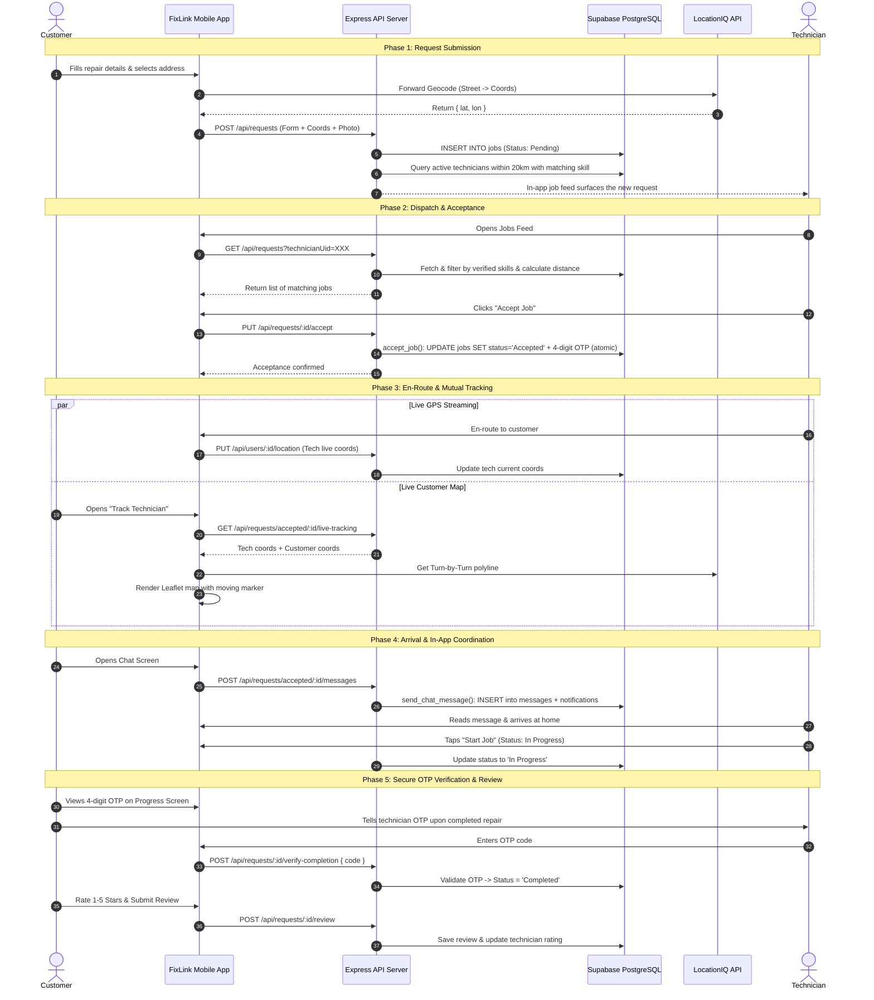

# System Architecture — FixLink: All-Around Technician Service Platform
**Cebu Roosevelt Memorial Colleges — College of Computer Studies**  
*Capstone Project / Systems Analysis and Design (SAD) — BSIT 2026*  
**Project Title:** FIXLINK: AN ALL-AROUND TECHNICIAN SERVICE PLATFORM FOR REPAIR REQUEST MANAGEMENT AND HOME-BASED TECHNICIAN DISPATCH  
**Researchers:** Jonard Masong, James Robert Rojas, Edsiel Ursal  
**Advisers:** Marjorie Reso, MIT | Dr. Jonel D. Gelig  

---

## 1. Chapter 1 Academic Problem-to-Architecture Mapping

This architecture directly resolves the five specific challenges established in **Chapter 1: Statement of the Problem (SOP)**:

| SOP # | Statement of the Problem (Chapter 1) | Architectural & Technical Solution |
|---|---|---|
| **1** | **Inefficient & Unreliable Technician Sourcing:** Relying on word-of-mouth or classified ads without skill guarantee. | **Skill-Based Verification & Dispatch Filter:** Mandatory credential checks (Government ID, TESDA certifications) paired with an automated matching engine filtering repair categories against registered technician skills. |
| **2** | **Lack of Real-Time Technician Availability:** Inability to know who is active and near the customer, causing severe delays. | **Real-Time GPS & Haversine Proximity Sorting:** Live technician location updates and Haversine distance computations (`distanceKm`) powering an on-demand jobs feed. |
| **3** | **Absence of a Centralized Repair Request Platform:** Informal handling, lost requests, and communication breakdowns. | **Centralized Request State-Machine (Supabase/PostgreSQL):** Formal lifecycle states (`Pending` → `Accepted` → `In Progress` → `Completed`) synchronized between Customer and Technician portals via a unified `jobs` table. |
| **4** | **Limited Livelihood for Part-Time/Unemployed Technicians:** Skilled workers lack access to consistent client sourcing. | **Technician Career Hub & Portfolio:** Direct digital pipeline to local service requests, in-app messaging, proof-of-work portfolio showcase, and verified rating reputation. |
| **5** | **Inconvenience of Transporting Bulky Appliances:** Burden of hauling refrigerators, washers, or computers to repair shops. | **Home-Based Dispatch & Mutual Live Map Routing:** Forward/reverse geocoding via LocationIQ API, turn-by-turn Leaflet.js road geometry, and privacy-shielded live navigation to customer homes. |

---

## 2. High-Level Three-Tier Architecture

FixLink is engineered on a decoupled three-tier architecture:

```
┌──────────────────────────────────────────────────────────────────────────┐
│                           PRESENTATION TIER                              │
│         React Native (Expo SDK 57) Cross-Platform Mobile Client          │
│                                                                          │
│   ┌───────────────────────────┐         ┌────────────────────────────┐   │
│   │   CUSTOMER INTERFACE      │         │   TECHNICIAN INTERFACE     │   │
│   │ • Dashboard & Alerts      │         │ • Verified Job Feed        │   │
│   │ • Appliance Request Form  │         │ • Proximity & Skill Filter │   │
│   │ • Real-time Order Tracking│         │ • Turn-by-Turn Map Route   │   │
│   │ • 4-Digit OTP Handshake   │         │ • 4-Digit OTP Verification │   │
│   │ • 5-Star Reviews & Chat   │         │ • Portfolio & Profile Hub  │   │
│   └─────────────┬─────────────┘         └─────────────┬──────────────┘   │
└─────────────────┼─────────────────────────────────────┼──────────────────┘
                  │ RESTful HTTP (Axios)                │ Multi-part Uploads
                  ▼                                     ▼
┌──────────────────────────────────────────────────────────────────────────────┐
│                     APPLICATION & LOGIC TIER                                  │
│                 Node.js + Express.js REST API Server                          │
│                                                                              │
│  • Authentication & Role Gatekeeper (`/api/auth`)                            │
│  • Automated Skill-Matching & Proximity Engine (`/api/requests`)             │
│  • Dynamic Distance Calculator (Haversine Formula)                           │
│  • OTP Code Generator & Cryptographic Verification (SQL RPC)                 │
│  • Media Handling Middleware (Multer Memory Storage)                         │
│  • User, Portfolio & Admin Credential Verifier (`/api/users`, `/admin`)      │
└─────────────────┬─────────────────────────────────────┬──────────────────────┘
                  │ Supabase service-role client        │ REST HTTP
                  ▼                                     ▼
┌───────────────────────────────────────┐ ┌────────────────────────────────┐
│             DATA TIER                 │ │         EXTERNAL SERVICES      │
│         Supabase (PostgreSQL)         │ │         LocationIQ API         │
│                                       │ │                                │
│ • `users` (Roles, Auth, Docs)         │ │ • Forward Geocoding (Address)  │
│ • `jobs` (Pending + Accepted states)  │ │ • Reverse Geocoding (Coords)   │
│ • `messages` + `message_reads` (Chat) │ │ • Driving Direction Polyline   │
│ • `reviews` (5-Star Ratings & Notes)  │ │ • Leaflet.js Interactive Tiles │
│ • `notifications` (Chat+Job, two-step, read/read_at) │ │ • Supabase Auth + JWT          │
│ • `announcements` (Admin Alerts)      │ │ • Supabase Storage (uploads)   │
│ • `categories` (Device catalog)       │ │                                │
└───────────────────────────────────────┘ └────────────────────────────────┘
```

---

## 3. Technology Stack Justification (From Capstone Proposal)

| Component | Technology | Rationale & Academic Justification |
|---|---|---|
| **Mobile Framework** | React Native (Expo SDK 57) | Cross-platform compatibility enabling single-codebase deployment to both Android and iOS devices, reducing maintenance overhead. |
| **Backend Runtime** | Node.js & Express.js | High-concurrency event-driven architecture well-suited for I/O-intensive operations such as location updates and multi-client request polling. |
| **Cloud Database** | Supabase (PostgreSQL) | Relational cloud database with row-level security, atomic transactions, SQL RPC functions, and free-tier hosting ideal for live demo tours without read/write metering. |
| **Authentication** | Supabase Auth & Custom JWT | Manages email/password signup, login, password recovery, and signed JWT verification for role-based route protection (`customer` vs. `technician` vs. `admin`). |
| **Geolocation & Maps** | LocationIQ API + Leaflet.js | Comprehensive geocoding and OSM-based turn-by-turn road routing without the prohibitive billing traps of Google Maps SDK. |
| **Map Rendering Engine**| React Native WebView + Leaflet | Embedded interactive HTML5 map component that smoothly renders markers, animated polylines, and popups across all mobile devices. |
| **File Storage** | Multer & Supabase Storage | Secure ingestion of technician government IDs, TESDA certificates, repair photos, and portfolio images into public Supabase storage buckets. |

---

## 4. Directory & Module Organization

```
Fixlinkmobile/
├── mobile/                                # React Native / Expo Mobile App (TypeScript)
│   ├── App.tsx / index.tsx                # Application entry points
│   ├── src/
│   │   ├── navigation/
│   │   │   └── AppNavigator.tsx           # State-driven role routing, tabs, notification inbox
│   │   ├── components/                    # Shared UI (AppButton, Skeleton, MessageBanner,
│   │   │                                  # LocationIQMap, sheets: Assistant, RecommendedTech,
│   │   │                                  # PortfolioPhoto, ConversationInfo, Help, ConfirmDialog)
│   │   ├── features/
│   │   │   ├── auth/                      # LoginScreen, RegisterScreen, ForgotPasswordScreen,
│   │   │   │                              # PasswordResetScreen, SplashScreen, VerifyPendingScreen
│   │   │   ├── customer/                  # DashboardScreen, SubmitRequestScreen,
│   │   │   │                              # RequestProgressScreen, RequestDetailsScreen,
│   │   │   │                              # CustomerProfileScreen, ChatScreen, RateTechnicianScreen
│   │   │   ├── technician/                # AvailableJobsScreen (+ availableJobs/ components),
│   │   │   │                              # TechJobDetailScreen, TechnicianProfileScreen, TechMapScreen
│   │   │   └── tracking/                  # MapTrackerScreen, TechnicianTrackerScreen
│   │   ├── services/
│   │   │   ├── api/                       # Split Axios client (client, authApi, requestsApi,
│   │   │   │                              # messagesApi, aiApi, trackingApi, profileApi, upload)
│   │   │   └── locationIq.tsx             # LocationIQ geocoding & route helper
│   │   ├── theme.tsx                      # Design tokens (colors, fonts, radii, spacing, shadows)
│   │   └── utils/applianceIcons.tsx       # Status colors, icons, guidance, progress steps
│
├── backend/                               # Node.js Express REST API Server (CommonJS)
│   ├── src/
│   │   ├── index.js                       # Express app bootstrap & middleware
│   │   ├── config/supabase.js             # Supabase service-role client & JWT verification
│   │   ├── routes/                        # Thin maps (registration order load-bearing;
│   │   │                                  # requests.js header documents the ordering rules)
│   │   ├── controllers/                   # jobController, chatController, trackingController,
│   │   │                                  # notificationController per-endpoint handlers
│   │   ├── services/                      # Business rules (jobs/*, ai/*, auth/*, workloadService,
│   │   │                                  # techScheduleService, technicianMatching, skillMatcher,
│   │   │                                  # chatService, notificationService, locationService, omniRoute)
│   │   ├── repositories/                  # Database access (job, message, notification, user, review)
│   │   ├── domain/                        # Serializers & policy (jobSerializer, otpPolicy, geo, ...)
│   │   ├── middleware/                    # requireAuth, requireAdmin, upload, rate limits
│   │   └── db/schema.sql                  # Idempotent Supabase PostgreSQL schema (source of truth)
│
└── context/                               # Project Source of Truth & SAD Docs (mirrored to backend/context/)
    ├── ARCHITECTURE.md                    # Detailed architectural blueprint
    ├── PRD.md                             # Product Requirements Document
    ├── SCHEMA.md                          # Supabase/PostgreSQL schemas & validations
    ├── UI_WORKFLOW.md                     # Complete UI wireflow & interaction guide
    ├── Data_Dictionary.md                 # Mobile-facing field dictionary
    └── CAPSTONE_CHAPTER3_AND_DEFENSE_GUIDE.md # SAD artifacts & defense guide
```

---

## 5. Core Business Logic & Algorithms

### 5.1 Skill-Based Matching & Categorization Algorithm
When a technician views available jobs (`GET /api/requests?technicianUid=...`), the backend executes the following filtering sequence:
1. **Verification Gate:** Checks if `technician.status === 'active'` or `technician.verificationStatus === 'verified'`. Unverified technicians receive an empty feed.
2. **Category Normalization:** Normalizes both the request category (`applianceType`) and technician skills (e.g., removing whitespace, casing, and slashes).
3. **Broad Match & Multi-Category Support:**
   - Exact or substring match (e.g., `refrigerator` matches `refrigerator repair`).
   - Computer umbrella match: If request is `Laptop`, `Computer Monitor`, or `Desktop Computer`, matches any technician with `Computer` or `Laptop` in their skill tags.
   - `General Repair` wildcard matches all standard home appliances.
   - `Others` tag specifically matches unlisted bespoke requests.
4. **Distance Calculation:** Computes Haversine distance between technician's current coordinates and customer's location.
5. **Privacy Guard:** While in `Pending` state, the customer's exact coordinates are never exposed to other technicians.

### 5.2 Secure 4-Digit OTP Completion Handshake
To prevent fraudulent completions and ensure physical technician presence:
1. On job acceptance (`PUT /api/requests/:id/accept`), the server generates a cryptographically random 4-digit code:
   $$\text{OTP} = \lfloor 1000 + \text{random}() \times 9000 \rfloor$$
2. The code is saved on the `jobs` record (column `verification_code`) in Supabase PostgreSQL, set atomically by the `accept_job()` RPC function.
3. The customer views this code securely in `RequestProgressScreen`.
4. Upon completing physical repair, the technician requests the code from the customer and enters it on their device (`POST /api/requests/:id/verify-completion`).
5. Only when the submitted code matches the database record is the status transitioned to `Completed`.

### 5.3 Privacy-Preserving Mutual Location Tracking
1. **Pending Status:** The customer's exact street address and exact latitude/longitude are hidden; only the town/city and approximate distance are visible.
2. **Accepted / In Progress Status:** Mutual live tracking unlocks. The technician's device sends coordinate updates via `PUT /api/users/:id/location`.
3. The customer polls `GET /api/requests/accepted/:id/live-tracking`, receiving both coordinates and LocationIQ driving geometry.
4. **Termination:** As soon as the job is marked `Completed` or `Cancelled`, all location streaming immediately ceases.

### 5.4 Technician Workload & Capacity System ( `backend/src/services/workloadService.js` )
**Active definition:** `Accepted`, `Confirmed`, `Customer Ready`, `In Progress` are active (require work); `Pending`, `Completed`, `Cancelled`, `No-Show` are not. Counted live via `getTechnicianActiveJobCount(uid)` / batch `getActiveJobCountsForTechnicians(uids)` (`select count head:true`).

**Levels:** `0–2 available` (fully eligible), `3–5 busy` (still eligible, slight priority dip), `6+ at_capacity` (excluded from automatic AI, existing jobs untouched, auto-recover when ≤5).

**Pipeline order (AI):** 1) verified/active gate + skill match (`technicianMatching.js:getEligibleCandidates`) → 2) workload annotate + filter `at_capacity` → 3) `rankObjective` + `-0.06` penalty for `busy` → 4) distance/rating/reviews/experience → 5) schedule visibility (`techScheduleService.js`) kept separate (workload ≠ same-day availability). Response adds `{activeJobs, workloadStatus}`.

**Accept guard (authoritative):** `PUT /api/requests/:id/accept` re-counts before `rpc accept_job`; if `at_capacity` → `409 {code:TECHNICIAN_AT_CAPACITY, activeJobs, workloadStatus}`. Handles race (AI advisory vs accept authoritative); recovery automatic on next `Completed`.

### 5.5 Notification Two-Step Deep-Link & Read Persistence ( `mobile/src/navigation/AppNavigator.tsx` )
`notifications` (`read/read_at`) serves badge `filter(!read).length` (10s poll `GET /api/requests/notifications` limit 100, sorted desc) and deep-link. **1st tap** → `detailCard` + optimistic `read=true` (badge –1, never negative) + fire-and-forget `PUT /api/requests/notifications/:id/read` (404 → keep optimistic, no warn). **2nd tap** same `id` → `GET /api/requests/job/:id` ownership check → `chat`→ exact `ChatScreen` thread, `job` Completed→ `RequestProgressScreen` `focusedJobId`+`autoExpandReview` (completed card `cardFocused`), other `job`→ `RequestDetailsScreen` / technician `AvailableJobsScreen` `highlightedJobId`. Deleted job → `detailError` keep notification, no crash. `read/read_at` persists across refresh/reopen/restart.

---

## 6. End-to-End Sequence Diagram


