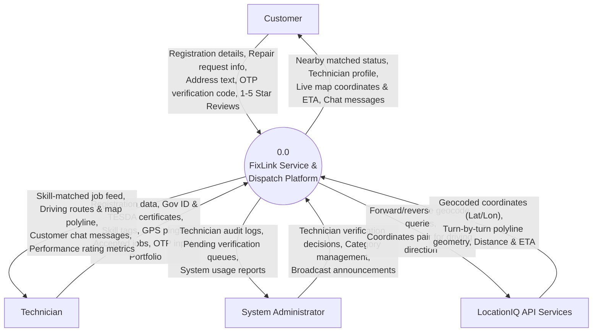
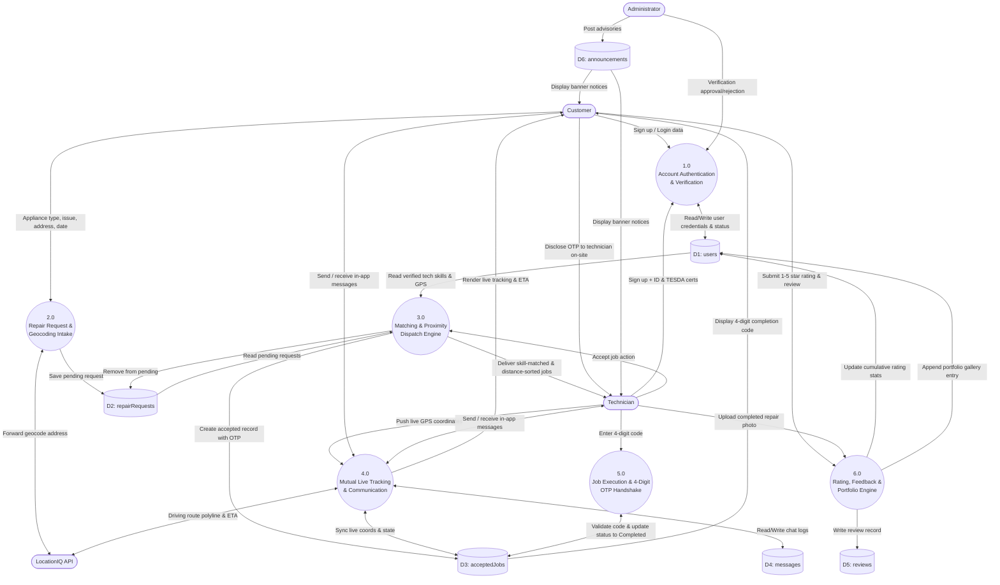
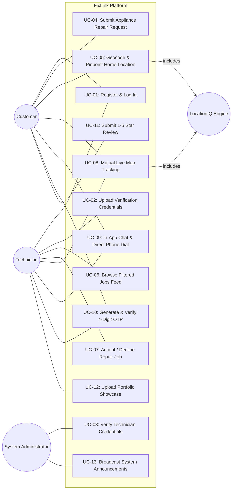

# Chapter 3: System Analysis and Design & Capstone Defense Guide
**Cebu Roosevelt Memorial Colleges — College of Computer Studies**  
*Bachelor of Science in Information Technology (BSIT)*  
*Course: Systems Analysis and Design (SAD) / Capstone Project — 2026*  

**Project Title:**  
`FIXLINK: AN ALL-AROUND TECHNICIAN SERVICE PLATFORM FOR REPAIR REQUEST MANAGEMENT AND HOME-BASED TECHNICIAN DISPATCH`

**Researchers:** Jonard Masong, James Robert Rojas, Edsiel Ursal  
**Faculty Advisers:** Carl Joshua Cosep | Marjorie Reso, MIT | Dr. Jonel D. Gelig  

---

# PART 1: CHAPTER 3 SYSTEM ANALYSIS & DESIGN (SAD) ARTIFACTS

---

## 1. Context Diagram (Data Flow Diagram — Level 0)

The Context Diagram establishes the boundary of the FixLink platform by defining the information flows between the core software system and external entities: **Customer**, **Technician**, **Administrator**, and **External Geocoding & Routing Services (LocationIQ)**.

---

## 2. Level 1 Data Flow Diagram (DFD Level 1)

The Level 1 DFD decomposes the system into six distinct functional processes and maps data exchanges with the six underlying Firestore data stores.

---

## 3. UML Use Case Diagram

---

## 4. Formal Use Case Specifications

### 4.1 Use Case: UC-04 (Submit Repair Request)
| Element | Specification |
|---|---|
| **Use Case ID** | **UC-04** |
| **Use Case Name** | Submit Appliance Repair Request |
| **Primary Actor** | Customer |
| **Secondary Actor**| LocationIQ Geocoding API |
| **Preconditions** | Customer is logged in with an active account. |
| **Postconditions** | Request is committed to `repairRequests` with status `Pending`; nearby matched technicians receive notifications. |
| **Main Flow** | 1. Customer navigates to "Submit Request". 2. Customer selects appliance category (e.g., Refrigerator) and describes failure symptoms. 3. Customer attaches a photograph of the damaged unit. 4. Customer taps "Locate Me" or types street address. 5. System invokes LocationIQ forward geocoding to resolve latitude/longitude. 6. Customer selects preferred appointment date and time slot. 7. Customer confirms submission. 8. System validates inputs and records request in Firestore. 9. System dispatches background push notifications to technicians within 20km possessing matching skills. |
| **Alternate Flows**| 4a. Location permission denied: Customer manually enters street address. 8a. Photo upload fails: System saves request without photo and notifies customer. |

---

### 4.2 Use Case: UC-07 (Accept & Dispatch Job)
| Element | Specification |
|---|---|
| **Use Case ID** | **UC-07** |
| **Use Case Name** | Accept & Dispatch Repair Job |
| **Primary Actor** | Technician |
| **Preconditions** | Technician is verified (`verificationStatus: 'verified'`) and authenticated. |
| **Postconditions** | Job moves to `acceptedJobs`, status updates to `Accepted`, 4-digit OTP generated, customer notified. |
| **Main Flow** | 1. Technician opens the "Available Jobs" feed. 2. System displays requests matching technician's verified skills, sorted by Haversine distance. 3. Technician reviews job summary and approximate proximity. 4. Technician clicks "Accept Job". 5. System moves the request record to `acceptedJobs` collection. 6. System generates a secure 4-digit OTP code stored in the job record. 7. System unmasks customer coordinates and unlocks the mutual live tracking map. |
| **Alternate Flows**| 4a. Technician clicks "Decline": Request is hidden from this technician's feed but remains available for other qualified technicians. |

---

### 4.3 Use Case: UC-10 (4-Digit OTP Completion Handshake)
| Element | Specification |
|---|---|
| **Use Case ID** | **UC-10** |
| **Use Case Name** | Secure Job Completion via 4-Digit OTP Handshake |
| **Primary Actors** | Customer, Technician |
| **Preconditions** | Job status is currently `In Progress`. |
| **Postconditions** | Job status transitions to `Completed`, mutual tracking ends, rating prompt unlocked. |
| **Main Flow** | 1. Technician physically completes the repair at the customer's residence. 2. Customer views the unique 4-digit OTP generated on their `RequestProgressScreen`. 3. Customer provides the 4-digit code to the technician. 4. Technician enters the code into the OTP modal on `AvailableJobsScreen`. 5. Backend matches submitted code against the stored database value. 6. Status transitions to `Completed`. 7. System records `completedAt` timestamp and triggers the customer rating dialog. |
| **Alternate Flows**| 5a. Incorrect code entered: System displays error alert and prevents completion until the correct code is supplied. |

---

# PART 2: CAPSTONE DEFENSE SLIDE DECK OUTLINE

---

### Slide 1: Title & Authors
* **Title:** FIXLINK: An All-Around Technician Service Platform for Repair Request Management and Home-Based Technician Dispatch
* **Institution:** Cebu Roosevelt Memorial Colleges — College of Computer Studies, Bogo City, Cebu
* **Degree:** Bachelor of Science in Information Technology (BSIT)
* **Researchers:** Jonard Masong, James Robert Rojas, Edsiel Ursal
* **Advisers:** Marjorie Reso, MIT | Dr. Jonel D. Gelig

---

### Slide 2: The Problem (Chapter 1 Statement of the Problem)
* Highlight the 5 community pain points:
  1. *Inefficient & Unreliable Sourcing:* Relying on word-of-mouth with zero skill verification.
  2. *Lack of Real-Time Availability:* No way to know which technician is nearby and free.
  3. *Absence of Centralized Platform:* Lost orders, scheduling mix-ups, unmonitored repairs.
  4. *Limited Technician Livelihood:* Part-time and unemployed technicians lack client marketing channels.
  5. *Inconvenience of Bulky Transport:* Carrying heavy appliances (refrigerators, washers) to distant shops.

---

### Slide 3: The Solution & Value Proposition
* **What is FixLink?** A specialized cross-platform mobile ecosystem bridging household appliance repair needs with local vetted technicians.
* **Core Value Pillars:**
  * Automated skill-category matching.
  * Home-service dispatch with turn-by-turn road navigation.
  * Fraud-proof 4-digit completion verification.
  * Digital livelihood portfolio for local tradespeople.

---

### Slide 4: Problem-to-Feature Alignment Matrix (Critical Defense Slide!)
*Demonstrates that every single research problem in Chapter 1 has a corresponding software feature:*

| # | Statement of the Problem (SOP) | FixLink Implemented Solution |
|---|---|---|
| 1 | Inefficient word-of-mouth sourcing | Admin Credential Verification (Gov ID & TESDA) + Skill-Category Matching |
| 2 | Lack of real-time availability | Live GPS Tracking + Haversine Proximity Sorting (`distanceKm`) |
| 3 | Absence of centralized platform | State-Machine Lifecycle (`Pending` $\rightarrow$ `Accepted` $\rightarrow$ `In Progress` $\rightarrow$ `Completed`) |
| 4 | Limited technician livelihood | Dedicated Jobs Feed, Portfolio Gallery, and Verified 5-Star Reviews |
| 5 | Bulky appliance transport hassle | Home-Based Dispatch with LocationIQ Turn-by-Turn Leaflet Map Routing |

---

### Slide 5: System Scope & Explicit Delimitations
* **In-Scope:** Customer request creation, technician onboarding with credentials, automated skill matching, LocationIQ geocoding, mutual live map tracking, in-app messaging, 4-digit OTP verification, 5-star ratings, portfolio showcase, admin panel.
* **Delimitations (Chapter 1 Compliance):**
  * *No In-App Payment Gateway:* Cash-on-Service direct arrangement between customer and technician.
  * *No Automated Hardware Diagnostics:* Facilitates operational dispatch; does not diagnose circuit board schematics.
  * *Platform-defined categories only* (Appliances, Computers, Electronics).
  * *Requires active internet connectivity*.

---

### Slide 6: System Architecture & Tech Stack
* **Three-Tier Architecture:** Presentation (React Native/Expo) $\leftrightarrow$ Logic (Node.js/Express) $\leftrightarrow$ Data (Firestore, LocationIQ API).
* **Tech Stack Rationale:**
  * *Expo SDK 57:* Single codebase for Android & iOS.
  * *Node.js + Express:* Lightweight, fast asynchronous I/O for coordinate streaming.
  * *Firebase Firestore:* Real-time document updates and security rules.
  * *LocationIQ API + Leaflet.js:* Cost-effective, high-accuracy geocoding and OSM street routing.

---

### Slide 7: Software Development Life Cycle (SDLC)
* **Model:** Agile Development Model.
* **Phases:**
  1. *Requirements Gathering:* Community interviews with CRMC stakeholders and local technicians.
  2. *Design:* Architectural blueprints, DFDs, and mobile UI wireframing.
  3. *Construction:* Sprints for Expo mobile app and Express API.
  4. *Testing & QA:* GPS tracking tests, skill matching filters, and OTP edge cases.
  5. *Deployment & Training:* Stakeholder orientation and user testing in Bogo City.
  6. *Feedback:* Continuous evaluation and iterative refinement.

---

### Slide 8: Analysis & Design (DFD Level 0 & Level 1)
* Showcase the Context Diagram and Level 1 DFD (from Part 1 of this document).
* Walk the panel through how a repair ticket moves from Customer $\rightarrow$ LocationIQ $\rightarrow$ Firestore $\rightarrow$ Technician Feed.

---

### Slide 9: Core Innovations & Technical Highlights
* **1. Skill-Category Matching Algorithm:** Normalization, exact matching, wildcard general repair, and computer umbrella grouping.
* **2. 4-Digit OTP Security Handshake:** Protects customers from unfulfilled jobs and guarantees physical technician presence.
* **3. Privacy-Shielded Geolocation:** Customer coordinates stay hidden in the unassigned jobs pool; precise location unlocks strictly after acceptance.

---

### Slide 10: Live System Demonstration
*(Execute live demonstration using two devices as detailed in Part 4 below).*

---

### Slide 11: Conclusions & Future Recommendations
* **Conclusions:** FixLink effectively eliminates the friction of sourcing repair technicians, provides on-site home service convenience, and empowers local skilled workers with consistent income opportunities.
* **Future Recommendations:**
  * Integration of local e-wallet gateways (GCash, Maya) in future iterations.
  * Native voice/video calling integration.
  * Expanding service categories to plumbing and automotive repair.

---

### Slide 12: Acknowledgments & Question and Answer
* Open floor for panel questions.

---

# PART 3: TOP ANTICIPATED DEFENSE QUESTIONS & ANSWERS

---

### Q1: "Why did you choose LocationIQ instead of Google Maps SDK?"
> **Ideal Answer:**  
> *"While Google Maps is widely known, its commercial SDK requires a linked credit card with high pay-as-you-go pricing risks for community capstone projects. LocationIQ provides enterprise-grade OpenStreetMap forward/reverse geocoding and road routing with generous free tier quotas, fully meeting our project's functional requirements without billing vulnerabilities. Furthermore, rendering it via Leaflet.js in a React Native WebView ensures fast, smooth cross-platform performance across both low-end and high-end devices."*

---

### Q2: "How does FixLink guarantee that a technician actually showed up and completed the repair?"
> **Ideal Answer:**  
> *"We implemented a two-factor physical verification handshake: the **4-digit OTP completion code**. When a job is accepted, the system generates a random 4-digit code visible exclusively on the customer's device. The technician cannot mark the job 'Completed' on their phone without entering this exact code. Because the customer only provides the code after inspecting the completed repair, it eliminates fraudulent completion claims and confirms the technician was physically present on-site."*

---

### Q3: "What prevents unverified individuals from accepting repair jobs?"
> **Ideal Answer:**  
> *"FixLink enforces an administrative verification gate. During registration, technicians must upload a government-issued identification card and a TESDA or vocational skill certificate. Their account is placed in a `pending_verification` state. Our backend dispatch engine (`/api/requests`) strictly queries technicians whose `verificationStatus` is marked `verified` and status is `active`. Unverified accounts receive an empty jobs feed."*

---

### Q4: "How is customer privacy protected before a technician accepts a job?"
> **Ideal Answer:**  
> *"In the pending jobs feed, the customer's exact coordinates and house address are masked. Technicians only see the general barangay or municipality name and an approximate distance calculated via the Haversine formula (e.g., '📍 3.2 km away'). Full street geometry and real-time mutual map tracking are unlocked strictly after the technician clicks 'Accept Job'."*

---

### Q5: "Why is there no in-app payment gateway included in the platform?"
> **Ideal Answer:**  
> *"As defined in our Chapter 1 Scope and Limitations, FixLink focuses on repair request management, skill matching, and home-based dispatch. Because repair pricing often varies based on on-site diagnostics, replacement parts, and unpredictable component costs, pricing is agreed upon and settled directly between customer and technician via Cash-on-Service. This prevents transaction disputes and eliminates third-party payment gateway fees for local part-time technicians."*

---

# PART 4: STEP-BY-STEP LIVE DEFENSE DEMONSTRATION SCRIPT

Prepare two mobile devices (or one mobile phone and one emulator):  
- **Device A:** Logged in as **Customer** (e.g., "Maria Santos")  
- **Device B:** Logged in as **Technician** (e.g., "Jonard - Verified Appliance Tech")  

---

| Step | Time | Device | Action to Perform | What to Explain to the Panel |
|---|---|---|---|---|
| **1** | 0:00 | Device A (Customer) | Open App $\rightarrow$ Show Home Dashboard. | *"Here is the Customer Dashboard displaying active advisories and the 2x3 appliance category grid."* |
| **2** | 0:30 | Device A (Customer) | Tap **"+ Request Service"** $\rightarrow$ Select **Refrigerator** $\rightarrow$ Type issue: *"Not cooling, compressor humming"* $\rightarrow$ Tap **"📍 Locate Me"**. | *"Notice how LocationIQ instantly reverse-geocodes the customer's current GPS location into an exact street address."* |
| **3** | 1:15 | Device A (Customer) | Tap **"Submit Request"** $\rightarrow$ Request enters `Pending` state. | *"The request is committed to Firestore and immediately evaluated by the skill-matching engine."* |
| **4** | 1:45 | Device B (Technician) | Open **"Available Jobs"** feed. | *"Notice that only technicians certified in Refrigerator repair see this job. The feed displays distance: '📍 1.8 km away', while exact house coordinates remain masked for privacy."* |
| **5** | 2:15 | Device B (Technician) | Tap **"Accept Job"**. | *"The request is atomically moved to `acceptedJobs`, and the customer is instantly notified."* |
| **6** | 2:45 | Both Devices | Open **"🗺️ Track on Live Map"**. | *"Both parties unlock mutual live tracking. The technician sees the LocationIQ driving route to the customer's house, and the customer watches the technician's approaching vehicle pin with live ETA."* |
| **7** | 3:30 | Device B (Technician) | Tap **"Start Job"** $\rightarrow$ Status changes to `In Progress`. | *"Upon arriving at the home, the technician begins the repair. The customer's screen now reveals the 4-digit security OTP."* |
| **8** | 4:00 | Device B (Technician) | Tap **"Complete Job"** $\rightarrow$ Enter Customer's 4-digit OTP. | *"The technician requests the code from the customer and enters it. The backend validates the code and transitions the job to `Completed`."* |
| **9** | 4:30 | Device A (Customer) | Rating dialog pops up $\rightarrow$ Rate 5 Stars $\rightarrow$ Submit Review. | *"The customer rates the service, instantly updating the technician's public reputation and review count."* |
| **10**| 5:00 | Device B (Technician) | Open **"Profile"** $\rightarrow$ View updated rating stats and portfolio. | *"The technician builds a verified proof-of-work portfolio without spending any money on advertising."* |
