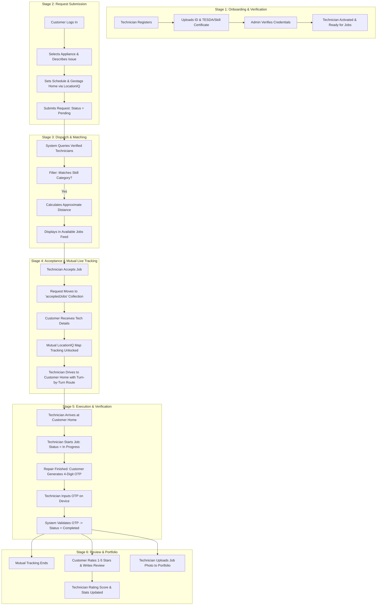
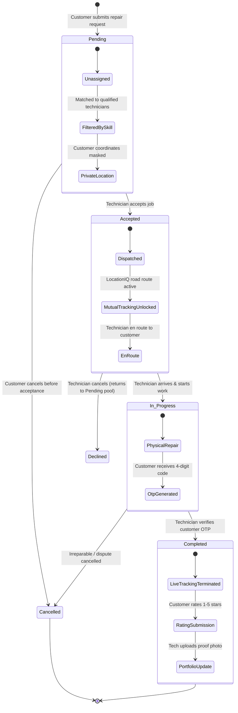
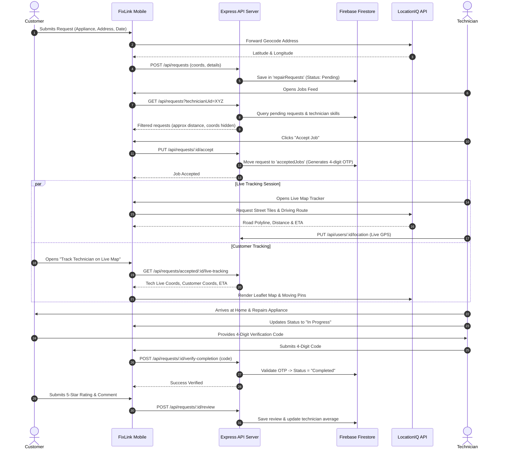

# FixLink: Comprehensive System Workflow & Architecture Plan
**Cebu Roosevelt Memorial Colleges — College of Computer Studies**  
*Bachelor of Science in Information Technology (BSIT)*  
*Capstone Project / Systems Analysis and Design (SAD)*

**Project Title:**  
`FIXLINK: AN ALL-AROUND TECHNICIAN SERVICE PLATFORM FOR REPAIR REQUEST MANAGEMENT AND HOME-BASED TECHNICIAN DISPATCH`

**Researchers:** Jonard Masong, James Robert Rojas, Edsiel Ursal  
**Advisers:** Marjorie Reso, MIT | Dr. Jonel D. Gelig  

---

## 1. Academic Problem-to-Feature Alignment Matrix

This matrix maps every specific challenge identified in **Chapter 1: Statement of the Problem (SOP)** directly to the functional modules of the FixLink platform.

| # | Chapter 1 Statement of the Problem (SOP) | FixLink System Module & Solution | Current Implementation Status in Codebase |
|---|---|---|---|
| **1** | **Inefficient & Unreliable Sourcing:** Relying on word-of-mouth or classified ads without skill guarantee. | **Skill-Based Verification & Category Matching:** Technicians undergo document verification and declare verified skill tags (appliances, computers, mobile phones, electronics). Requests match only qualified technicians. | ✅ Implemented in backend dispatch filter (`backend/src/routes/requests.js`) & register (`RegisterScreen.js`). |
| **2** | **Lack of Real-Time Technician Availability:** Inability to know who is active and near the customer, leading to delays. | **Real-Time GPS Availability & Distance Sorting:** Live coordinates tracking via LocationIQ; available requests feed sorts by proximity (`distanceKm`). | ✅ Implemented via LocationIQ Geocoding & Haversine distance calculator in `requests.js`. |
| **3** | **Absence of Centralized Platform:** Informal handling, lost requests, miscommunication. | **Centralized Request Lifecycle Management:** Structured Firestore state machine (`Pending` &rarr; `Accepted` &rarr; `In Progress` &rarr; `Completed`) with dedicated Customer and Technician dashboards. | ✅ Implemented across Customer (`RequestProgressScreen`) and Technician (`AvailableJobsScreen`). |
| **4** | **Limited Livelihood for Part-Time/Unemployed:** Skilled workers lack access to consistent client sourcing. | **On-Demand Technician Portal & Portfolio:** Technicians build an online profile, portfolio gallery, and reputation score (ratings & reviews) without spending on ads. | ✅ Implemented in `TechnicianProfileScreen` and backend portfolio uploads (`/api/users/:id/portfolio`). |
| **5** | **Inconvenience of Transporting Bulky Items:** Burden of hauling refrigerators, washers, or desktop units to repair shops. | **Home-Based Service & Mutual Live Map Tracking:** Customer geotags their home; accepted technicians navigate directly to the customer's house using turn-by-turn LocationIQ map routing. | ✅ Implemented in `LocationIQMap.js` and `MapTrackerScreen.js`. |

---

## 2. Scope and Delimitation Boundaries

### In-Scope Modules (Core System Requirements)
1. **Customer Request Submission:** Appliance categorization, issue details, scheduled date/time, photo attachment, and geotagged home address.
2. **Technician Onboarding & Skill Verification:** Uploading Government ID and Skill/TESDA Certification; skill selection across platform categories.
3. **Automated Matching Engine:** Smart categorization filter ensuring only technicians with matching verified skills see and accept matching repair jobs.
4. **Location-Based Dispatch:** Distance estimation and route generation using LocationIQ API.
5. **Mutual Location Tracking:** Live GPS tracking activated **strictly after job acceptance**, protecting customer privacy while requests remain pending.
6. **In-App Communication:** Basic real-time messaging and direct phone dialer between matched customer and technician.
7. **Secure Job Verification:** 4-digit completion code generated by customer to ensure technician is physically on-site and the repair is finished before marking `Completed`.
8. **Rating, Feedback & Portfolio:** 5-star customer review system and technician portfolio showcasing verified repairs.
9. **Admin Portal:** User management, technician credential verification, and transaction auditing.

### Explicit Delimitations (Out of Scope as Stated in Capstone Paper)
- **No In-App Payment Gateway:** Cash-on-Service / direct arrangement between customer and technician (no credit card/Stripe/GCash API required).
- **No Automated Hardware Diagnostics:** The system connects people; it does not diagnose circuit board failures or run diagnostic tests.
- **Categorization Limits:** Limited to the admin-managed skill categories (dynamically loaded from Firestore `categories`), e.g., Home Appliances, Mobile Devices, Networking & Internet Devices, Computer & Laptop, Other Electronic Devices.
- **Network Dependency:** Requires active internet connection.

---

## 3. End-to-End System Workflow (The 6-Stage Lifecycle)

---

## 4. Detailed Actor Use Cases & Workflows

### Actor 1: Customer Workflow
1. **Account Registration / Login:** Authenticates using email/password.
2. **Home Dashboard:** Views active service announcements and past repair history.
3. **Submit Repair Request:**
   - Selects appliance category from the admin-managed skill category list (e.g., *Home Appliances*, *Computer & Laptop*, *Mobile Devices*), then picks the specific device (e.g., *Washing Machine*, *Laptop*) from that category's drop-down.
   - Enters problem description and attaches an image of the damaged device.
   - Taps **"Locate Me"** (reverse geocoded via LocationIQ) or types exact street address.
   - Selects preferred date and appointment time.
   - Submits request (status: `Pending`).
4. **Privacy Shield:** While request is `Pending`, technician locations are hidden, and technician cannot see customer's exact map coordinates.
5. **Job Matched & Accepted:**
   - Customer is notified of assigned technician name, rating, and contact.
   - **"Track Technician on Live Map"** button activates.
   - Customer monitors approaching technician in real time, viewing live distance (km) and ETA (minutes).
6. **In-App Coordination:** Chats or calls technician for gate pass/landmark clarification.
7. **Job Verification:** Upon completion of the repair, customer provides the generated 4-digit code to the technician.
8. **Feedback:** Rates technician 1 to 5 stars and writes service review.

---

### Actor 2: Technician Workflow
1. **Registration & Skill Tagging:**
   - Selects repair skills (*General Repair, Mobile Phone, Tablet, Laptop, Refrigerator, Washing Machine, etc.*).
   - Uploads government-issued ID and trade certifications.
2. **Account Approval:** Admin reviews documents and activates account status.
3. **Available Jobs Feed:**
   - Views available repair requests filtered strictly to match verified skills.
   - Jobs are sorted by distance from the technician's current location (`distanceKm`).
   - Customer's exact location coordinates are masked for privacy until acceptance.
4. **Job Acceptance:**
   - Technician clicks **"Accept Job"**.
   - Request is moved to technician's assigned jobs list.
5. **Live Navigation & Dispatch:**
   - Technician opens **"🗺️ Open Live Tracker & Route"**.
   - LocationIQ interactive map renders turn-by-turn road geometry, live distance, and travel time to the customer's doorstep.
   - Technician can switch between external navigation (Google Maps) and in-app tracker.
6. **Job Execution:**
   - Taps **"Start Job"** (status updates to `In Progress`).
   - Performs diagnostic and physical repair at customer's home.
7. **Secure Completion:**
   - Requests the 4-digit verification code from the customer.
   - Submits code to backend &rarr; system marks job `Completed`.
8. **Portfolio & Profile Growth:**
   - Uploads before/after photos of the repaired device to the profile portfolio.

---

### Actor 3: Administrator Workflow
1. **User Account Governance:** Oversees customer and technician accounts.
2. **Technician Verification:** Reviews uploaded Government IDs and certificates to mark technicians `verified` / `active`.
3. **System Platform Categories:** Configures supported appliance and device categories.
4. **Announcements Management:** Posts platform-wide advisories, service notices, or safety guidelines.
5. **Audit & Dispute Resolution:** Monitors request logs, completion timestamps, and customer reviews.

---

## 5. State Machine: Service Request Lifecycle

---

## 6. Sequence Diagram: Request, Mutual Tracking & Completion Flow

---

## 7. Current Project Status vs. Capstone Defense Checklist

| Feature Requirement | Capstone Status | Implementation File Reference |
|---|---|---|
| **Role-Based Auth (Customer/Technician)** | ✅ Complete | [AppNavigator.js](file:///c:/CAPSTONE/Fixlinkmobile/mobile/src/navigation/AppNavigator.js), [LoginScreen.js](file:///c:/CAPSTONE/Fixlinkmobile/mobile/src/screens/auth/LoginScreen.js) |
| **Document Upload for Verification** | ✅ Complete | [RegisterScreen.js](file:///c:/CAPSTONE/Fixlinkmobile/mobile/src/screens/auth/RegisterScreen.js), [auth.js](file:///c:/CAPSTONE/Fixlinkmobile/backend/src/routes/auth.js) |
| **Appliance Service Submission** | ✅ Complete | [SubmitRequestScreen.js](file:///c:/CAPSTONE/Fixlinkmobile/mobile/src/screens/customer/SubmitRequestScreen.js) (**static list replaced by admin-managed dynamic categories via `GET /api/users/platform/categories`**) |
| **LocationIQ Geocoding & Route Engine** | ✅ Complete | [locationIq.js](file:///c:/CAPSTONE/Fixlinkmobile/mobile/src/screens/services/locationIq.js) |
| **Interactive Leaflet WebView Map** | ✅ Complete | [LocationIQMap.js](file:///c:/CAPSTONE/Fixlinkmobile/mobile/src/components/LocationIQMap.js) |
| **Mutual Tracking & Privacy Enforcement** | ✅ Complete | [MapTrackerScreen.js](file:///c:/CAPSTONE/Fixlinkmobile/mobile/src/screens/shared/MapTrackerScreen.js), [requests.js](file:///c:/CAPSTONE/Fixlinkmobile/backend/src/routes/requests.js) |
| **Smart Skill Categorization Dispatch** | ✅ Complete | [requests.js (lines 80-125)](file:///c:/CAPSTONE/Fixlinkmobile/backend/src/routes/requests.js) |
| **4-Digit OTP Job Completion Code** | ✅ Complete | [AvailableJobsScreen.js](file:///c:/CAPSTONE/Fixlinkmobile/mobile/src/screens/technician/AvailableJobsScreen.js), [requests.js (lines 270-302)](file:///c:/CAPSTONE/Fixlinkmobile/backend/src/routes/requests.js) |
| **5-Star Rating & Review System** | ✅ Complete | [RequestProgressScreen.js](file:///c:/CAPSTONE/Fixlinkmobile/mobile/src/screens/customer/RequestProgressScreen.js), [requests.js (lines 220-245)](file:///c:/CAPSTONE/Fixlinkmobile/backend/src/routes/requests.js) |
| **Technician Profile & Portfolio Uploads**| ✅ Complete | [TechnicianProfileScreen.js](file:///c:/CAPSTONE/Fixlinkmobile/mobile/src/screens/technician/TechnicianProfileScreen.js), [users.js](file:///c:/CAPSTONE/Fixlinkmobile/backend/src/routes/users.js) |
| **In-App Direct Calling & Messaging** | ✅ Complete | [ChatScreen.js](file:///c:/CAPSTONE/Fixlinkmobile/mobile/src/screens/customer/ChatScreen.js), [RequestDetailsScreen.js](file:///c:/CAPSTONE/Fixlinkmobile/mobile/src/screens/customer/RequestDetailsScreen.js) |
| **Admin Web/API Verification Panel** | ⚙️ Backend Ready | [admin.js](file:///c:/CAPSTONE/Fixlinkmobile/backend/src/routes/admin.js) |
