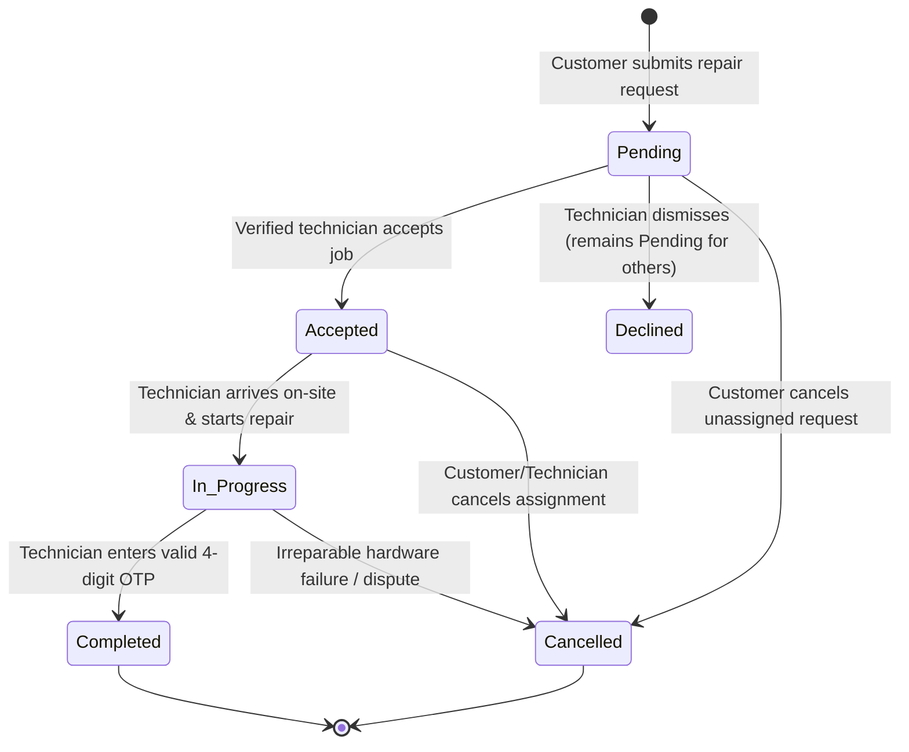

# Data Schema Specification — FixLink Mobile
**Cebu Roosevelt Memorial Colleges — College of Computer Studies**  
*Bachelor of Science in Information Technology (BSIT) — Capstone 2026*  
**Database Engine:** Supabase (PostgreSQL) — Hosted Relational Database  
**Implementation Artifact:** `backend/src/db/schema.sql` (run in Supabase SQL Editor)

---

## 1. Schema Overview & Entity Relationship

FixLink models its data on a unified **state-machine `jobs` table** that consolidates what was previously split across two collections. Instead of "moving" a record between a pending pool and an accepted pool, a job's `status` column drives its lifecycle with a single atomic row.

```mermaid
erDiagram
    USERS ||--o{ JOBS : creates
    USERS ||--o{ JOBS : fulfills
    USERS ||--o{ REVIEWS : receives
    JOBS ||--|{ MESSAGES : contains
    JOBS ||--o| REVIEWS : "generates upon completion"
    MESSAGES ||--o{ MESSAGE_READS : "read by"
    USERS ||--o{ NOTIFICATIONS : receives
    USERS ||--o{ PASSWORD_RESETS : "issued reset links"

    USERS {
        uuid id PK "Supabase Auth user id"
        text role
        text name
        text email
        text phone
        text status
        text verification_status
        text government_id_file_url
        text certificate_file_url
        text[] skills
        double precision latitude
        double precision longitude
        jsonb portfolio
        timestamptz created_at
    }

    JOBS {
        uuid id PK
        uuid original_request_id "legacy audit self-reference"
        uuid customer_uid FK
        text customer_name
        uuid technician_uid FK
        text technician_name
        text appliance_type
        text description
        text location
        double precision latitude
        double precision longitude
        text status "Pending/Accepted/In Progress/Completed/Cancelled"
        text verification_code "4-digit OTP"
        uuid review_id FK
        timestamptz created_at
    }

    MESSAGES {
        uuid id PK
        uuid job_id FK
        uuid sender_uid FK
        text sender_name
        text sender_role
        text text
        timestamptz timestamp
    }

    MESSAGE_READS {
        uuid message_id PK,FK
        uuid user_uid PK,FK
        timestamptz read_at
    }

    REVIEWS {
        uuid id PK
        uuid technician_uid FK
        text technician_name
        text customer_name
        int rating
        text comment
        uuid request_id FK
        timestamptz created_at
    }

    NOTIFICATIONS {
        uuid id PK
        uuid recipient_uid FK
        uuid job_id FK
        uuid message_id FK
        text type
        boolean read
        timestamptz timestamp
    }

    PASSWORD_RESETS {
        uuid id PK
        uuid user_id FK
        text token_hash "SHA-256 fingerprint of the reset token"
        timestamptz expires_at
        timestamptz used_at "non-null once redeemed (single-use)"
    }
```

---

## 2. Table Specifications

### 2.1 `users`
Stores credential, profile, verification, and live location data for both Customers and Technicians. `id` is the **Supabase Auth user UUID** (`auth.users.id`).

| Column | Type | Requirement | Description |
|---|---|---|---|
| `id` | `uuid` PK | **Required** | Primary Key; references `auth.users(id)`. |
| `name` | `text` | **Required** | User's full legal name. |
| `email` | `text` | **Required** | Unique email address used for login. |
| `phone` | `text` | Optional | Contact mobile number. |
| `role` | `text` | **Required** | `'customer'`, `'technician'`, or `'admin'`. |
| `status` | `text` | Optional | `'active'`, `'pending_verification'`, or `'rejected'`. |
| `verification_status` | `text` | Optional | `'unverified'`, `'pending'`, `'verified'`, `'rejected'`. |
| `rejection_reason` | `text` | Optional | Reason when a technician application is rejected. |
| `government_id_number` | `text` | Technicians | Government-issued ID number. |
| `government_id_file_url` | `text` | Technicians | Public URL of uploaded government ID. |
| `certificate_file_url` | `text` | Technicians | Public URL of uploaded TESDA/vocational certificate. |
| `skills` | `text[]` | Technicians | Skill badge list, e.g. `['Refrigerator','Washing Machine','General Repair']`. |
| `years_experience` | `int` | Technicians | Years of repair experience. |
| `latitude` / `longitude` | `double precision` | Optional | Last reported GPS coordinate. |
| `location_updated_at` | `timestamptz` | Optional | Timestamp of the most recent location ping. |
| `fcm_token` | `text` | Optional | Reserved for push notifications. |
| `portfolio` | `jsonb` | Technicians | Proof-of-work repairs: `[{ title, description, imageUrl, completedAt }]` or `[{ name, url, uploadedAt }]`. |
| `rating` | `double precision` | Optional | Aggregated average rating (1.0–5.0). |
| `total_reviews` | `int` | Optional | Count of submitted reviews. |
| `profile_image` | `text` | Optional | Public URL of the profile picture. |
| `created_at` | `timestamptz` | **Required** | Account creation timestamp. |

---

### 2.2 `jobs` (consolidated)
Represents the **entire request lifecycle**: unassigned pending requests and accepted/completed workflows live in one row keyed by `status`. This replaces the Firestore `repairRequests` + `acceptedJobs` pair.

| Column | Type | Requirement | Description |
|---|---|---|---|
| `id` | `uuid` PK | **Required** | Auto-generated job identifier. |
| `original_request_id` | `uuid` | Optional | Legacy audit self-reference; keeps old dual-ID lookups working. |
| `customer_uid` | `uuid` FK | Optional | References `users.id` of the requesting customer. |
| `customer_name` | `text` | **Required** | Customer display name for the job ticket. |
| `technician_uid` | `uuid` FK | Optional | References `users.id` of the assigned technician. |
| `technician_name` | `text` | Optional | Name of the assigned technician. |
| `appliance_type` | `text` | **Required** | Device name (e.g., `'Washing Machine'`, `'Laptop'`) or parent category. |
| `category` | `text` | Optional | Parent admin-managed category (e.g., `'Home Appliances'`). |
| `description` | `text` | **Required** | Customer's description of the failure. |
| `location` | `text` | **Required** | Formatted address or community landmark. |
| `latitude` / `longitude` | `double precision` | Optional | Geocoded service-location coordinates. |
| `preferred_date` / `preferred_time` | `text` | Optional | Requested service date/time slot. |
| `scheduled_date` | `text` | Optional | Full scheduled date-time string. |
| `photo_url` | `text` | Optional | Public URL of the uploaded appliance photo. |
| `status` | `text` | **Required** | Lifecycle state below. |
| `is_other` | `boolean` | Optional | Free-text "other" device flag. |
| `declined_by` | `uuid` FK | Optional | Technician who dismissed this job from their feed. |
| `verification_code` | `text` | On accept | 4-digit OTP generated atomically on acceptance. |
| `accepted_at` | `timestamptz` | On accept | Timestamp of acceptance. |
| `started_at` | `timestamptz` | Optional | Timestamp repair began. |
| `completed_at` | `timestamptz` | Optional | Timestamp of verified completion. |
| `cancelled_at` | `timestamptz` | Optional | Timestamp of cancellation. |
| `location_updated_at` | `timestamptz` | Optional | Latest customer live-location ping. |
| `review_id` | `uuid` FK | Optional | Associated review (`reviews.id`). |
| `reviewed_at` | `timestamptz` | Optional | Review submission timestamp. |
| `created_at` | `timestamptz` | **Required** | Request submission timestamp. |

**Status values:** `Pending` → `Accepted` → `Confirmed` → `Customer Ready` → `In Progress` → `Completed` (via OTP), with `Cancelled` and `No-Show` branches. **Active workload statuses (technician capacity):** `Accepted`, `Confirmed`, `Customer Ready`, `In Progress` (counted for workload; `Pending`, `Completed`, `Cancelled`, `No-Show` are not active).

---

### 2.3 `messages`
Flat chat table (replaces the Firestore `acceptedJobs/{jobId}/messages` subcollection). One message per row, joined to its job.

| Column | Type | Requirement | Description |
|---|---|---|---|
| `id` | `uuid` PK | **Required** | Auto-generated message ID. |
| `job_id` | `uuid` FK | **Required** | References `jobs.id`. |
| `sender_uid` | `uuid` | **Required** | UID of the posting user. |
| `sender_name` | `text` | **Required** | Display name of the sender. |
| `sender_role` | `text` | **Required** | `'customer'` or `'technician'`. |
| `text` | `text` | **Required** | Chat body text. |
| `timestamp` | `timestamptz` | **Required** | Transmission timestamp. |

### 2.4 `message_reads`
Associates readers with messages (replaces the Firestore `readBy[]` array). Composite PK `(message_id, user_uid)`.

| Column | Type | Requirement | Description |
|---|---|---|---|
| `message_id` | `uuid` PK/FK | **Required** | References `messages.id`. |
| `user_uid` | `uuid` PK/FK | **Required** | References `users.id`. |
| `read_at` | `timestamptz` | **Required** | When the message was read. |

---

### 2.5 `reviews`
Captures 5-star feedback and written testimonials for completed repairs.

| Column | Type | Requirement | Description |
|---|---|---|---|
| `id` | `uuid` PK | **Required** | Auto-generated review ID. |
| `technician_uid` | `uuid` FK | **Required** | References `users.id` of the reviewed technician. |
| `technician_name` | `text` | **Required** | Name of the technician. |
| `customer_name` | `text` | **Required** | Name of the evaluating customer. |
| `rating` | `int` | **Required** | Integer `1`–`5`. |
| `comment` | `text` | Optional | Qualitative feedback. |
| `request_id` | `uuid` FK | **Required** | References `jobs.id` of the completed job. |
| `created_at` | `timestamptz` | **Required** | Review submission timestamp. |

---

### 2.6 `notifications`
In-app unread/read badge + two-step deep-link system for chat and job workflow.

| Column | Type | Requirement | Description |
|---|---|---|---|
| `id` | `uuid` PK | **Required** | Auto-generated notification ID. |
| `recipient_uid` | `uuid` FK | **Required** | References `users.id` of the receiver. |
| `sender_uid` | `uuid` FK | Optional | References `users.id` of the sender. |
| `sender_name` | `text` | Optional | Sender display name. |
| `job_id` | `uuid` FK | Optional | References `jobs.id` (`on delete cascade` – if job deleted, row removed, but UI keeps optimistic read). |
| `message_id` | `uuid` FK | Optional | References `messages.id`. |
| `type` | `text` | **Required** | `'chat'` (new message) or `'job'` (`Request Update`/`Accepted`/`Completed`); `'system'` reserved and not currently emitted. |
| `text` | `text` | Optional | Short notification body (never title-only routing). |
| `read` | `boolean` | **Required** | Unread/read flag – first tap flips `read=true` (optimistic) and badge `filter(!read).length` decrements by 1, never negative. |
| `read_at` | `timestamptz` | Optional | Read timestamp set on `PUT /api/requests/notifications/:id/read`. |
| `timestamp` | `timestamptz` | **Required** | Creation timestamp (sort `desc`, limit 100). |

**Two-step interaction ( `mobile/src/navigation/AppNavigator.js` ):** 1st tap → show `detailCard` (sender/text/time/jobCode) + optimistic `read=true` + fire-and-forget `PUT …/read` (404 → keep optimistic, no warn). 2nd tap same `id` → `GET /api/requests/job/:id` validate ownership → `chat`→ exact `ChatScreen` thread (`jobId`), `job` Completed→ `RequestProgressScreen` `focusedJobId`+`autoExpandReview` (completed card highlighted), otherwise `RequestDetailsScreen`/technician `AvailableJobsScreen` `highlightedJobId`.

**Persistence:** `read/read_at` persisted in `notifications`; badge derived from `GET /api/requests/notifications` (`read + unread`, not legacy `GET /api/requests/messages/unread` unread-only). Re-poll 10s, reopen, or restart all reflect DB state. Mark failure 404 keeps optimistic, other errors revert and show `detailError`.

---

### 2.7 `announcements`
Broadcasts administrative notices across the platform.

| Column | Type | Requirement | Description |
|---|---|---|---|
| `id` | `uuid` PK | **Required** | Unique identifier. |
| `title` | `text` | **Required** | Headline text. |
| `message` | `text` | **Required** | Full announcement body. |
| `active` | `boolean` | **Required** | Display toggle. |
| `created_at` | `timestamptz` | **Required** | Creation timestamp. |

---

### 2.8 `categories`
Admin-managed skill categories; `devices` drives the customer device picker and technician skill chips.

| Column | Type | Requirement | Description |
|---|---|---|---|
| `id` | `uuid` PK | **Required** | Auto-generated ID. |
| `name` | `text` (unique) | **Required** | Category name, e.g., `'Home Appliances'`. |
| `devices` | `jsonb` | **Required** | Device list under the category. |
| `created_at` / `updated_at` | `timestamptz` | Optional | Creation/update timestamps. |

---

### 2.9 `password_resets`
Backs **single-use** password-reset links. When a reset link is issued for an account, any still-unused rows for that user are deleted and one row is inserted holding a one-way fingerprint of the signed reset token. Redeeming a link marks the row `used_at` in a single atomic update, so the same link can never succeed twice.

| Column | Type | Requirement | Description |
|---|---|---|---|
| `id` | `uuid` PK | **Required** | Auto-generated ID. |
| `user_id` | `uuid` FK | **Required** | References `users.id`; cascade deletes on account removal. |
| `token_hash` | `text` | **Required** | SHA-256 (`token + RESET_TOKEN_SECRET`) fingerprint; the raw token is never stored. |
| `expires_at` | `timestamptz` | **Required** | Full link expiry (24 hours, matches JWT `exp`). |
| `used_at` | `timestamptz` | Optional | Becomes non-null on successful redemption (single-use marker). |
| `created_at` | `timestamptz` | **Required** | Issuance timestamp. |

Indexes: `password_resets_token_hash_idx (token_hash)`, `password_resets_user_id_idx (user_id)`, `password_resets_expires_at_idx (expires_at)`.

---

### 2.10 `workload` (virtual, computed — no migration)

Workload is **not stored** as a column; it is computed live from `jobs`:

- **Definition:** `activeJobs = COUNT(*) FROM jobs WHERE technician_uid = :uid AND status IN ('Accepted','Confirmed','Customer Ready','In Progress')` (helpers `backend/src/utils/workload.js:getTechnicianActiveJobCount`, `getActiveJobCountsForTechnicians` via `count head:true` + fallback `select id`). `Pending`, `Completed`, `Cancelled`, `No-Show` are **not** counted.
- **Levels:** `0–2 → available`, `3–5 → busy`, `6+ → at_capacity` (`getWorkloadStatus`).
- **AI filtering:** `GET /api/ai/recommend` annotates `candidate.activeJobs/workloadStatus`, filters `at_capacity` out, applies `-0.06` score penalty for `busy` (does not overpower skill/rating/distance). Response exposes `{activeJobs, workloadStatus}` (no customer PII).
- **Accept guard:** `PUT /api/requests/:id/accept` recalculates count before `rpc accept_job`; if `at_capacity` → `409 {code:'TECHNICIAN_AT_CAPACITY', activeJobs, workloadStatus}`. Advisory (AI) + authoritative (accept) prevents stale-race over-accept; automatic recovery when count falls to `≤5`.
- **Endpoint:** `GET /api/requests/technician/:uid/workload → {activeJobs, workloadStatus}` (auth: `uid===auth`).

---

## 3. State Machine & Status Validation Rules

### Transition Invariants
1. `Pending → Accepted` — implemented atomically by the `accept_job()` RPC function: assigns the technician, generates the 4-digit OTP, and flips `status` in a single transaction.
2. `Accepted → In Progress` — only the assigned technician can invoke.
3. `In Progress → Completed` — strictly blocked unless the submitted `verificationCode` matches the value generated upon acceptance.
4. `Completed → Review` — a completed job allows exactly one review (`job.review_id` acts as the guard).

---

## 4. Atomic Business Functions (RPC)

Defined in `backend/src/db/schema.sql`:

| Function | Purpose |
|---|---|
| `accept_job(job_id, technician_uid, technician_name)` | Atomically assigns + generates OTP + transitions to `Accepted`. |
| `send_chat_message(job_id, sender_uid, sender_name, sender_role, text)` | Inserts message and fans out the chat notification together. |
| `recompute_technician_rating(technician_uid)` | Recomputes `users.rating` / `users.total_reviews` from `reviews`. |

Backend access runs through the **service_role** key (bypasses Row Level Security); the mobile app never connects to the database directly.