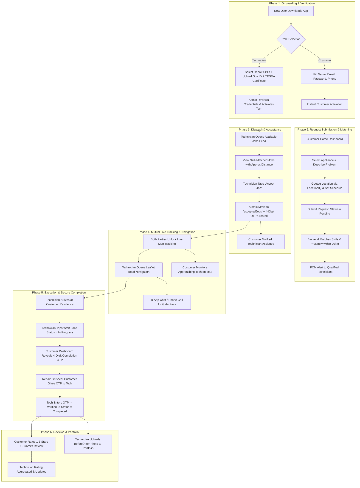

# FixLink: Detailed System Workflow & UI Design Flow
**Cebu Roosevelt Memorial Colleges — College of Computer Studies**  
*Bachelor of Science in Information Technology (BSIT) — Capstone Project 2026*  
**System Title:** FIXLINK: AN ALL-AROUND TECHNICIAN SERVICE PLATFORM FOR REPAIR REQUEST MANAGEMENT AND HOME-BASED TECHNICIAN DISPATCH  
**Researchers:** Jonard Masong, James Robert Rojas, Edsiel Ursal  

---

## 1. System Philosophy & Workflow Overview

FixLink is designed to resolve the five core challenges documented in **Chapter 1: Statement of the Problem**:
1. **Inefficient word-of-mouth sourcing** $\rightarrow$ Skill-based automated matching engine.
2. **Lack of real-time technician availability** $\rightarrow$ Live GPS tracking and proximity-sorted feeds.
3. **Absence of a centralized platform** $\rightarrow$ Unified status pipeline (`Pending` $\rightarrow$ `Accepted` $\rightarrow$ `In Progress` $\rightarrow$ `Completed`).
4. **Limited job opportunities for technicians** $\rightarrow$ Dedicated technician jobs feed, portfolio builder, and review profiles.
5. **Inconvenience of hauling bulky appliances** $\rightarrow$ On-site home service powered by LocationIQ turn-by-turn routing.

---

## 2. Global UI Design System & Aesthetic Standards

The visual design follows a modern, accessible, and high-contrast color scheme tailored for readability in both indoor and outdoor service environments.

### 2.1 Color Palette
| Token | Hex Code | Purpose |
|---|---|---|
| `ink` | `#102A43` | Primary text, titles, deep slate contrast elements. |
| `teal` | `#0F766E` | Primary brand accent, primary CTA buttons, active tabs. |
| `tealLight`| `#E6F6F3` | Active tab background, selected category pills, highlighted banners. |
| `canvas` | `#F5F8FA` | Neutral soft background across all app screens. |
| `white` | `#FFFFFF` | Card surfaces, modals, elevated UI panels. |
| `muted` | `#829AB1` | Secondary text, placeholders, inactive tabs, dividers. |
| `line` | `#D9E2EC` | Border strokes, card outlines, subtle separators. |
| `gold` | `#F59E0B` | 5-star ratings, system alerts, high-priority notifications. |
| `danger` | `#E53E3E` | Decline buttons, error badges, cancellation actions. |
| `success` | `#10B981` | Completed badges, verified checkmarks. |

### 2.2 Typography Scale
- **Display / Brand:** 25px–28px, Extra Bold (`fontWeight: '900'`), negative letter spacing (`-1.2px`).
- **Screen Title:** 22px–24px, Bold (`fontWeight: '800'`), dark ink color.
- **Section Kicker / Overline:** 10px–11px, All Caps, Bold (`letterSpacing: 1.5px`), brand teal.
- **Card Headline:** 15px–17px, Semi-Bold (`fontWeight: '700'`).
- **Body Copy:** 13px–14px, Regular (`lineHeight: 20px`), muted or dark ink.
- **Micro / Meta Labels:** 10px–11px, Medium (`fontWeight: '600'`), distance badges, timestamps.

---

## 3. End-to-End Persona Journey Workflows

---

## 4. Screen-by-Screen UI Design & Interaction Specifications

### Screen 1: Unified Authentication (`LoginScreen.js`)
- **Purpose:** Secure entry point providing role-agnostic authentication for both Customers and Technicians.
- **Visual Layout:**
  - **Header:** FixLink logo in dark ink with teal accent (`fixlink`), subtitle: `"All-Around Technician Service Platform"`.
  - **Form Fields:** 
    - Email address input with envelope icon.
    - Password input with secure text entry toggle.
  - **Action Controls:**
    - Primary CTA: Large rounded Teal button `"Sign In"`.
    - Secondary Link: `"Forgot Password?"` $\rightarrow$ navigates to `ForgotPasswordScreen`.
    - Bottom Switcher: `"Don't have an account? Sign Up"` $\rightarrow$ navigates to `RegisterScreen`.
- **System Interactions:**
  - On submit: Calls `POST /api/auth/login`.
  - Validates credentials against Firebase Auth.
  - Fetches user profile from Firestore `users` collection.
  - Dynamically routes user to either **Customer Navigation Stack** or **Technician Navigation Stack** based on `role`.

---

### Screen 2: Role-Based Registration (`RegisterScreen.js`)
- **Purpose:** Onboarding portal that dynamically shifts layout depending on whether the registrant is a Customer or a Technician.
- **Visual Layout & Role Toggle:**
  - Top segmented switch: `[ I am a Customer ]` | `[ I am a Technician ]`.
  - **Common Fields:** Full Name, Email, Password, Phone Number.
  - **Technician-Specific Section (Expands conditionally):**
    - **Skill Selection Chips:** Multi-select pills (`Refrigerator`, `Washing Machine`, `Desktop Computer`, `Laptop`, `Television`, `General Repair`, `Others`). Selected skills highlight in bold teal.
    - **Document Upload Cards:**
      1. *Government-Issued ID:* Photo capture / image picker for National ID, Driver's License, or Passport.
      2. *TESDA / Vocational Certificate:* Proof of technical training or competency certification.
    - Info banner: *"Your credentials will be verified by CRMC FixLink administrators before you can accept jobs."*
  - **Action Controls:**
    - Primary CTA: `"Create Customer Account"` or `"Submit Technician Registration"`.
- **System Interactions:**
  - Uploads multipart documents to local storage / Google Cloud Storage.
  - Creates user record in `users` with `verificationStatus: 'pending'` for technicians.

---

### Screen 3: Customer Home & Dashboard (`DashboardScreen.js`)
- **Purpose:** High-level customer command center displaying platform announcements, service categories, and active request statuses.
- **Visual Layout:**
  - **Header Bar:** Brand wordmark (`fixlink`), subtitle `"HOME SERVICES"`, bell icon with unread indicator dot opening the announcements modal.
  - **Hero Welcome Banner:** Dark ink card with teal glow: *"Have a broken appliance? Submit a request and get matched with nearby verified technicians."*
  - **Quick Action Button:** Prominent teal CTA button: `"+ Request Repair Service"`.
  - **Service Category Grid (2x3 matrix):**
    - `Refrigerator` (icon: fridge / snow)
    - `Washing Machine` (icon: water / sync)
    - `Desktop Computer` (icon: desktop)
    - `Laptop` (icon: laptop)
    - `Electronics / TV` (icon: tv)
    - `General / Others` (icon: construct)
  - **Recent Activity Section:**
    - Preview card of the latest active repair request with status pill (`Pending` in yellow, `Accepted` in teal).
    - Tapping card opens `RequestDetailsScreen` or `RequestProgressScreen`.

---

### Screen 4: Repair Request Submission (`SubmitRequestScreen.js`)
- **Purpose:** Multi-input service intake form allowing customers to describe damage, geotag their home, and set service preferences.
- **Visual Layout & Interaction Flow:**
  - **Step 1: Appliance Category & Device Selector:** Two-step drill-down modal. Step 1 lists the platform **skill categories** managed by the admin (`GET /api/users/platform/categories` → Firestore `categories` collection). Tapping a category opens Step 2 (**Select Device**) listing that category's specific `devices` (header shows the category name + back arrow). Tapping a device selects it; a category with no devices is selected directly. The input shows `Category — Device` (e.g., `Home Appliances — Washing Machine`).
  - **Step 2: Issue Description:** Multi-line text area with placeholder: *"Describe the issue (e.g., Refrigerator motor making loud noise, not cooling since yesterday)..."*.
  - **Step 3: Photo Attachment:**
    - Camera / Gallery picker button.
    - Thumbnail preview of the uploaded appliance photo with a remove (X) button.
  - **Step 4: Location & Address (LocationIQ Integration):**
    - Text input for street address.
    - **"📍 Locate Me"** button: Triggers device GPS, calls LocationIQ Reverse Geocoding, and auto-populates street name and coordinates (`latitude`, `longitude`).
  - **Step 5: Preferred Schedule:**
    - Date picker input (`YYYY-MM-DD`).
    - Preferred time window dropdown (`Morning 8AM-12PM`, `Afternoon 1PM-5PM`, `Evening`).
  - **Submission Bar:**
    - Fixed bottom container with prominent button: `"Submit Repair Request"`.
- **System Interactions:**
  - Posts payload to `POST /api/requests`.
  - Invokes backend matching logic (`triggerMatching`) to dispatch FCM push notifications to technicians within 20km.
  - Navigates customer to `RequestProgressScreen`.

---

### Screen 5: Active Request Progress & Timeline (`RequestProgressScreen.js`)
- **Purpose:** Real-time lifecycle tracker for customers to follow the progress of their active repair tickets.
- **Visual Layout:**
  - **Header:** `"Active Service Requests"`.
  - **Status Progress Indicator (Stepped Horizontal Tracker):**
    `[ 1. Submitted ]` $\rightarrow$ `[ 2. Accepted ]` $\rightarrow$ `[ 3. In Progress ]` $\rightarrow$ `[ 4. Completed ]`
  - **Assigned Technician Card (Visible once `Accepted`):**
    - Technician avatar, full name, verified badge icon.
    - Star rating average (e.g., `★ 4.9 (24 jobs)`).
    - Quick Action Buttons:
      - **"🗺️ Track Technician on Live Map"** $\rightarrow$ opens `MapTrackerScreen`.
      - **"💬 Chat"** $\rightarrow$ opens `ChatScreen`.
      - **"📞 Call"** $\rightarrow$ opens phone dialer with technician's registered contact number.
  - **Security OTP Card (Visible when `In Progress`):**
    - High-visibility golden alert box:
      - Headline: *"Job Completion Security Code"*.
      - Large display of 4-Digit OTP: **`[ 5 ] [ 2 ] [ 9 ] [ 1 ]`**.
      - Subtext: *"Only give this 4-digit code to the technician after the repair is physically completed at your home."*
  - **Review & Feedback Card (Visible once `Completed`):**
    - Star rating selector (interactive 1 to 5 stars).
    - Multi-line text field for customer feedback.
    - Submit Review button calling `POST /api/requests/:id/review`.

---

### Screen 6: Detailed Request Summary (`RequestDetailsScreen.js`)
- **Purpose:** Full administrative breakdown of an individual repair order for historical auditing and deep review.
- **Visual Layout:**
  - Request ID banner with copy-to-clipboard button.
  - High-resolution preview of the attached broken device photo.
  - Detailed metadata list: Appliance Type, Date Reported, Preferred Schedule, Full Geocoded Address.
  - Assigned technician profile overview.
  - Direct navigation button to live tracking map if status is active.

---

### Screen 7: Technician Available Jobs Feed (`AvailableJobsScreen.js`)
- **Purpose:** Primary workstation for technicians to discover nearby service leads that match their verified skills.
- **Visual Layout & Matching Feed:**
  - **Top Filter & Status Bar:**
    - Live active/available toggle switch.
    - Distance filter chip (e.g., `< 10 km`, `< 20 km`, `All`).
  - **Job Feed Cards (Proximity Sorted):**
    - **Header Row:** Appliance category badge (`Refrigerator` in blue pill), distance pill (`📍 3.2 km away` in teal).
    - **Issue Summary:** Customer-reported problem snippet.
    - **Location Shield:** General town/barangay shown (e.g., *"San Vicente, Bogo City"*); exact coordinates remain hidden until accepted.
    - **Preferred Schedule:** Date and time slot.
    - **Action Row:**
      - Decline Button (Red text: `"Decline"`): Dismisses card from this technician's feed without affecting other technicians.
      - Accept Button (Teal filled: `"Accept Job"`): Prompts confirmation modal.
  - **Active Jobs Section:**
    - Once a job is accepted, it docks at the top of the screen in an "Active Job in Progress" card.
    - Action Buttons on Active Card:
      - **"Open Live Tracker"** $\rightarrow$ opens `MapTrackerScreen` with route navigation.
      - **"Start Job"** $\rightarrow$ updates status from `Accepted` to `In Progress`.
      - **"Complete Job (Enter OTP)"** $\rightarrow$ launches 4-digit code entry modal.
- **Completion Modal (Technician Side):**
  - Numeric keypad / 4-box OTP input.
  - Validates against backend `POST /api/requests/:id/verify-completion`.
  - On match: Displays success confetti, marks job `Completed`, and prompts technician to upload before/after photos to their portfolio.

---

### Screen 8: Mutual Live Map Tracker (`MapTrackerScreen.js`)
- **Purpose:** Full-screen interactive map displaying live mutual tracking between customer home and en-route technician.
- **Visual Layout:**
  - **Interactive Leaflet WebView Map:**
    - **Customer Pin:** House icon at customer's geocoded address.
    - **Technician Pin:** Moving technician vehicle / wrench marker tracking live coordinates.
    - **Route Polyline:** LocationIQ driving route drawn in vibrant teal along actual street geometry.
  - **Floating Top HUD:**
    - Remaining distance badge: `3.4 km`.
    - Estimated Time of Arrival: `12 mins`.
  - **Floating Bottom Card:**
    - Name and photo of other party.
    - Contact buttons (Call & Chat).
    - **"Open External Google Maps"** button: Deep-links to native Google Maps navigation for turn-by-turn spoken driving instructions.

---

### Screen 9: In-App Chat Messenger (`ChatScreen.js`)
- **Purpose:** Threaded communication channel tied to a specific accepted job for real-time coordination.
- **Visual Layout:**
  - **Header Bar:** Contact name, role indicator (`Technician` or `Customer`), phone call icon.
  - **Message Stream:**
    - Customer messages: White bubbles aligned to the left.
    - Technician messages: Teal bubbles aligned to the right.
    - Timestamps beneath each bubble (`10:42 AM`).
  - **Bottom Input Bar:**
    - Text input: *"Type a message..."*.
    - Send button: Teal paper plane icon. Calls `POST /api/requests/accepted/:id/messages`.

---

### Screen 10: Technician Profile & Portfolio Hub (`TechnicianProfileScreen.js`)
- **Purpose:** Livelihood hub enabling technicians to display credentials, track ratings, and upload completed repair portfolios.
- **Visual Layout:**
  - **Profile Header:** Profile photo, full name, verified badge, member since date.
  - **Reputation Metrics Grid:**
    - `★ 4.9` Average Rating
    - `38` Jobs Completed
    - `100%` Verified
  - **Verified Skill Tags:** Badges representing administrator-approved competencies (`Refrigerator`, `Washing Machine`, `Computer`).
  - **Portfolio Gallery (Proof-of-Work):**
    - Grid of completed repair projects with photos and captions (e.g., *"Samsung Inverter Refrigerator PCB repair"*).
    - `+ Add Project` button opening photo upload and description modal.
  - **Account Controls:** Availability toggle switch (`Available for Jobs` / `Offline`), Logout button.

---

### Screen 11: Customer Profile & History (`CustomerProfileScreen.js`)
- **Purpose:** Customer account management, completed repair history, and settings.
- **Visual Layout:**
  - User name, email, phone number.
  - **Service History List:** Cards of past completed repairs with review ratings and dates.
  - Support & FAQ link.
  - Logout button.

---

## 5. UI State Machine & Interaction Flow Matrix

| Source Screen | Trigger Action | Condition / Payload | Destination / UI Response |
|---|---|---|---|
| `LoginScreen` | Tap "Sign In" | Valid Customer Credentials | Redirect to `DashboardScreen` (Customer Stack) |
| `LoginScreen` | Tap "Sign In" | Valid Technician Credentials | Redirect to `AvailableJobsScreen` (Tech Stack) |
| `DashboardScreen` | Tap "+ Request Service" | User clicks button or category | Opens `SubmitRequestScreen` with pre-selected category |
| `SubmitRequestScreen` | Tap "Locate Me" | GPS permission granted | LocationIQ reverse-geocodes coords $\rightarrow$ auto-fills address |
| `SubmitRequestScreen` | Tap "Submit Request" | Valid fields & photo | Saves to `repairRequests` $\rightarrow$ opens `RequestProgressScreen` |
| `AvailableJobsScreen` | Tap "Accept Job" | Job is pending & within skill | Moves to `acceptedJobs`, creates OTP $\rightarrow$ opens Active Card |
| `AvailableJobsScreen` | Tap "Decline" | Technician dismisses job | Job hidden from this technician's local feed |
| `AvailableJobsScreen` | Tap "Open Live Tracker" | Job status = `Accepted` | Opens `MapTrackerScreen` with driving route |
| `RequestProgressScreen`| Tap "Track Technician" | Job status = `Accepted` | Opens `MapTrackerScreen` showing approaching technician |
| `MapTrackerScreen` | Tap "Call" / "Chat" | Active job context | Launches phone dialer or transitions to `ChatScreen` |
| `AvailableJobsScreen` | Tap "Complete Job" | Tech enters customer's 4-digit OTP | Validates code $\rightarrow$ updates status to `Completed` |
| `RequestProgressScreen`| Job marked `Completed` | Customer sees prompt | Rating modal opens $\rightarrow$ submits 1-5 star review |
| `TechnicianProfileScreen`| Tap "+ Add Project" | Photo + title entered | Uploads to portfolio and updates profile gallery |
